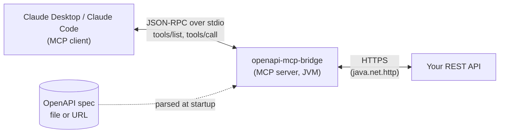

# openapi-mcp-bridge

[](https://github.com/filipopov/openapi-mcp-bridge/actions/workflows/ci.yml)


[](LICENSE)

**Turn any OpenAPI 3 spec into MCP tools.** Point the bridge at a spec (file or URL) and a base URL, and every
operation becomes a [Model Context Protocol](https://modelcontextprotocol.io) tool that Claude Desktop, Claude Code
or any other MCP client can call. You don't write tool definitions by hand: the input schema comes from the spec's
path, query and header parameters and the request body, and calling a tool sends the HTTP request and returns the
response.

**Author:** Filip Popov · [LinkedIn](https://linkedin.com/in/filipopov)



## Quick start

Requires Java 21+.

```bash
git clone https://github.com/filipopov/openapi-mcp-bridge.git
cd openapi-mcp-bridge
./mvnw -B verify                       # build + unit tests + end-to-end test over stdio
# -> target/openapi-mcp-bridge.jar (self-contained fat jar)

# See which tools a spec produces (prints JSON, does not start the server):
java -jar target/openapi-mcp-bridge.jar --spec examples/petstore.yaml --list-tools
```

The bundled [`examples/petstore.yaml`](examples/petstore.yaml) points at the public Swagger Petstore demo
(`https://petstore3.swagger.io/api/v3`), so you can try it against a live API without any setup.

### Claude Desktop

Add this to `claude_desktop_config.json` (macOS: `~/Library/Application Support/Claude/`, Windows: `%APPDATA%\Claude\`)
and restart Claude Desktop:

```json
{
  "mcpServers": {
    "petstore": {
      "command": "java",
      "args": [
        "-jar", "/absolute/path/to/openapi-mcp-bridge.jar",
        "--spec", "/absolute/path/to/examples/petstore.yaml"
      ]
    },
    "my-api": {
      "command": "java",
      "args": ["-jar", "/absolute/path/to/openapi-mcp-bridge.jar"],
      "env": {
        "OPENAPI_MCP_SPEC": "https://api.example.com/openapi.json",
        "OPENAPI_MCP_BASE_URL": "https://api.example.com",
        "OPENAPI_MCP_INCLUDE": "tag:orders,tag:customers",
        "OPENAPI_MCP_HEADER_AUTHORIZATION": "Bearer <your-token>"
      }
    }
  }
}
```

A copy lives in [`examples/claude_desktop_config.json`](examples/claude_desktop_config.json). If `java` on Claude
Desktop's `PATH` is older than 21, use the absolute path to a Java 21 binary as `command`.

### Claude Code

```bash
claude mcp add petstore -- \
  java -jar /absolute/path/to/openapi-mcp-bridge.jar --spec /absolute/path/to/examples/petstore.yaml

# With auth, kept out of the command line via an environment variable:
claude mcp add my-api \
  -e OPENAPI_MCP_HEADER_AUTHORIZATION="Bearer $MY_API_TOKEN" \
  -- java -jar /absolute/path/to/openapi-mcp-bridge.jar \
     --spec https://api.example.com/openapi.json --base-url https://api.example.com
```

Then ask Claude something like *"Which pets are available in the petstore?"* and it will call `findPetsByStatus`.

## Options

Every option has an environment variable equivalent; command-line arguments win.

| Option | Env variable | Default | Description |
|---|---|---|---|
| `--spec <file\|url>` | `OPENAPI_MCP_SPEC` | *(required)* | OpenAPI 3.0/3.1 document (YAML or JSON). Swagger 2.0 is converted automatically. |
| `--base-url <url>` | `OPENAPI_MCP_BASE_URL` | first `servers` entry | Base URL that operation paths are appended to. Server variables use their defaults; a relative server URL is resolved against a spec URL. |
| `--allow-writes` | `OPENAPI_MCP_ALLOW_WRITES` | `false` | Also expose `POST`, `PUT`, `PATCH`, `DELETE` (and other non-GET/HEAD) operations. |
| `--include <pattern>` | `OPENAPI_MCP_INCLUDE` | *(all)* | Only expose matching operations. Repeatable / comma-separated. See [Filters](#filters). |
| `--exclude <pattern>` | `OPENAPI_MCP_EXCLUDE` | *(none)* | Hide matching operations. Applied after `--include`. |
| `-H, --header 'Name: value'` | `OPENAPI_MCP_HEADER_<NAME>` | *(none)* | Static header sent with every request (auth, API keys, tenant IDs). Repeatable. `OPENAPI_MCP_HEADER_X_API_KEY` becomes `X-Api-Key`. |
| `--timeout <seconds>` | `OPENAPI_MCP_TIMEOUT` | `30` | Connect and request timeout. |
| `--max-response-bytes <n>` | `OPENAPI_MCP_MAX_RESPONSE_BYTES` | `102400` | Bodies larger than this are truncated, and the result says so. |
| `--list-tools` | | | Print the generated tool definitions as JSON to stdout and exit. |
| `-v, --verbose` | | | Debug logging (stderr). |

## Safety model

You're handing an API to an LLM, so the defaults are conservative:

- **Read-only by default.** Only `GET` and `HEAD` operations become tools. Write operations appear only with
  `--allow-writes`, and include patterns can't override this. Tools carry MCP annotations (`readOnlyHint`,
  `destructiveHint` for `DELETE`, `idempotentHint`) so clients can ask for confirmation before a write.
- **Least privilege through filters.** Expose only the slice of the API the assistant needs, e.g.
  `--include tag:orders --exclude 'op:delete*'`.
- **Secrets stay out of logs and arguments.** Static headers come from `--header` or, better, from
  `OPENAPI_MCP_HEADER_*` environment variables, so they don't show up in process listings or client configs as
  arguments. Header values are never logged, the config's `toString()` prints only header names, and any configured
  secret that ends up in an error message is masked (`****`). Per-request logs contain only method, path (no query
  string), status and duration.
- **Logs never corrupt the protocol.** All logging goes to stderr; stdout carries only MCP JSON-RPC messages.
- **Bounded calls.** Every request has a timeout, and response bodies are capped. Binary responses (images, PDFs,
  octet streams) are summarized instead of being dumped into the model's context.
- **Errors are data, not exceptions.** HTTP 4xx/5xx, timeouts and connection failures come back as tool results
  with `isError: true` plus the status and body, so the model can see what went wrong and react.
- **Inputs are validated.** The MCP SDK validates arguments against the generated JSON schema before a request is
  sent (missing required fields, wrong types, unknown properties). Path parameters are percent-encoded so a value
  like `../admin` can't escape its path segment, and header values containing CR/LF are rejected.

Exposing writes to an LLM is still your decision. Use credentials scoped to what you're comfortable letting an
assistant do.

## How the mapping works

| OpenAPI | MCP tool |
|---|---|
| `operationId` | Tool name, sanitized to `[A-Za-z0-9_-]`, max 64 chars (long names get a short hash suffix), duplicates suffixed `_2`, `_3`. Without an `operationId`: `get_pets_petId` from `GET /pets/{petId}`. |
| `summary` + `description` | Tool description (plus the `HTTP METHOD /path` line); `summary` is also the tool title. Deprecated operations are prefixed `[DEPRECATED]`. |
| Path / query / header / cookie parameters | Top-level properties of the input schema. Path-level parameters are inherited and can be overridden per operation. Path parameters are always required. If two locations use the same name (e.g. `id` in path and query), the later one becomes `query_id`. `Accept`, `Content-Type` and `Authorization` header parameters are ignored, as the OpenAPI spec says. |
| Request body | A `body` property (`requestBody` if a parameter is already called `body`), required if the body is required. JSON media types (`application/json`, `*+json`) are preferred, then form-urlencoded, then text/XML. |
| `$ref` (schemas, parameters, request bodies) | Inlined, so clients that don't follow refs still see the full shape. Recursive schemas are expanded once and then cut off with an explanatory description. |
| `nullable`, `example`, `xml`, `discriminator`, `x-*` | `nullable: true` becomes a `"null"` type. The rest are dropped, since they aren't JSON Schema. |

Example: `getPetById` from the Petstore becomes

```json
{
  "name": "getPetById",
  "description": "Find pet by ID.\n\nReturns a single pet.\n\nHTTP GET /pet/{petId}",
  "inputSchema": {
    "type": "object",
    "properties": {
      "petId": { "type": "integer", "format": "int64", "description": "ID of pet to return" }
    },
    "required": ["petId"],
    "additionalProperties": false
  }
}
```

and a call returns a single text block such as

```
HTTP 200
Content-Type: application/json

{"id":7,"name":"Rex","photoUrls":[],"status":"available"}
```

Request serialization follows the OpenAPI defaults: query parameters use `form` style (arrays exploded as
`tags=a&tags=b` unless `explode: false`, `deepObject` as `filter[color]=blue`), path and header parameters use
`simple` style, and cookie parameters are joined into a `Cookie` header.

## Design notes

- **Plain MCP Java SDK, no Spring.** The tools aren't known at compile time; they're generated from a spec at
  startup. The SDK's `McpServer.sync(...)` with `SyncToolSpecification`s fits that directly, while Spring AI's
  annotation-driven tool model is built for tools written as Java methods. Without Spring the bridge is one small
  `main`, starts in well under a second (which matters because MCP clients spawn the process on demand), and has
  no web server to configure for a stdio-only program.
- **Jackson 2 throughout.** The SDK's `mcp` aggregate artifact pulls in Jackson 3. swagger-parser is on Jackson 2,
  so the build uses `mcp-core` + `mcp-json-jackson2` to keep a single Jackson line (aligned with `jackson-bom`).
- **`java.net.http.HttpClient`** for outbound calls: no extra dependency, HTTP/2, timeouts built in.
- **picocli** for the CLI (options, env var defaults, help), **slf4j-simple** for logging (writes to stderr out of
  the box).
- **Testing without Docker or network.** Unit tests cover the spec-to-tool mapping (Petstore plus a deliberately
  awkward spec, an OpenAPI 3.1 spec and a Swagger 2.0 spec) and request execution against an in-process JDK
  `HttpServer` stub. A failsafe integration test launches the **packaged fat jar** as a child process and drives it
  with the SDK's `McpSyncClient` over stdio, the same way Claude Desktop does.

Project layout:

```
src/main/java/io/github/filipopov/openapimcp/
├── Main.java                 CLI (picocli), wiring, stdio server start
├── config/BridgeConfig.java  immutable config, header parsing (CLI + env)
├── openapi/                  spec loading, filtering, naming, schema conversion, operation -> tool mapping
├── http/                     HTTP execution, response formatting, secret redaction
└── server/BridgeServer.java  ToolDefinition -> MCP SDK tool specifications
```

## Limitations and what's next

Current limitations:

- **stdio transport only.** Streamable HTTP is supported by the SDK through its servlet-based transport, but that
  needs a servlet container, which is out of scope for 0.1.0.
- **Auth is static headers only.** `securitySchemes` aren't interpreted, so there's no OAuth flow and no automatic
  API-key placement in query strings or cookies. Pass the right header yourself.
- **No multipart or binary request bodies.** Operations that only accept `multipart/form-data` or
  `application/octet-stream` are skipped (they show up as skipped in `--verbose` logs).
- Only the first `servers` entry is used. Per-path and per-operation `servers` overrides are ignored.
- Only JSON, form-urlencoded and plain-text/XML request bodies are supported. Response schemas aren't turned into
  MCP `outputSchema`, and results are returned as text.
- External `$ref`s are loaded by swagger-parser at startup. Refs that can't be resolved are replaced by an
  explanatory description instead of failing.

Ideas for later:

- Streamable HTTP transport (e.g. embedded Jetty) for remote or shared deployments
- `securitySchemes`-aware auth (API key in query/cookie, OAuth2 client credentials)
- `outputSchema` + `structuredContent` from response schemas
- Hot reload of the spec and `notifications/tools/list_changed`
- Native image build (GraalVM) for instant startup

## License

[MIT](LICENSE) © Filip Popov. The Petstore example is adapted from the
[Swagger Petstore](https://github.com/swagger-api/swagger-petstore) sample (Apache 2.0).
